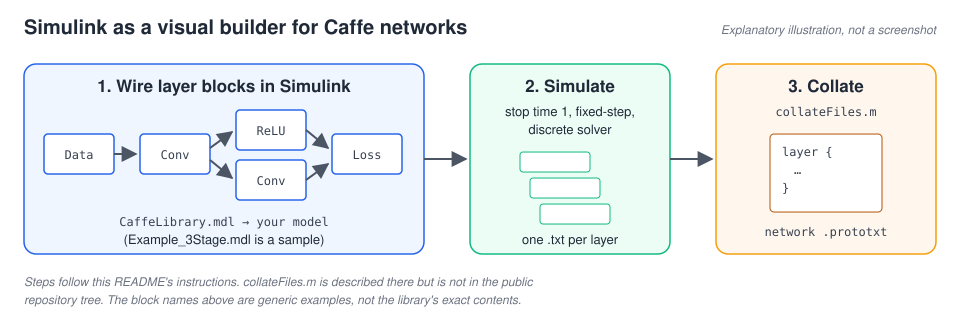

# Simulink-Caffe-Builder

Simulink-Caffe-Builder is a 2015 experiment in editing Caffe network definitions as connected
Simulink blocks. MATLAB functions embedded in the blocks format Caffe layer definitions and
are designed to write text files during model simulation; this review did not simulate them. The aim was to reduce manual editing of network
configuration files; the Simulink model does not execute the corresponding neural network.

*Source-level workflow schematic, not a screenshot. The final collation script is not included in the repository.*

## Repository contents

- [CaffeLibrary.mdl](CaffeLibrary.mdl): block library with data source, convolution, pooling,
  `NeuronLayer`, `ReLULayer` and loss blocks. Embedded MATLAB functions write layer text to `.txt` files.
- [Example_3Stage.mdl](Example_3Stage.mdl): an example graph that connects these blocks.

The models contain configuration generation logic, not Caffe weights, a numerical inference
engine or a training loop. Running a Caffe model requires a separate Caffe installation and
compatible data and configuration files.

## Original export procedure

This procedure is incomplete and was not executed for the documentation review.

MATLAB and Simulink are required. The saved models use MATLAB Function blocks; a compatible
release must support their embedded code and model format. No current MATLAB release has been
validated for this repository.

1. Copy the models into a fresh writable directory with no other `.txt` files. Start MATLAB,
   change to that directory and run `simulink`.
2. Open `CaffeLibrary.mdl` and `Example_3Stage.mdl` to inspect the library and example.
3. For a new model, set the stop time to `1`, the solver type to **Fixed-step**, and the solver
   to **discrete** in Simulation → Configuration Parameters.
4. Copy blocks from the library, edit their parameters and connect their inputs and outputs.
5. Simulate the model to invoke the embedded text-writing functions.

The original instructions then call `collateFiles.m` to combine the layer files into one
`.prototxt` network definition. **That script is absent from the tracked repository.** The
end-to-end export procedure is therefore incomplete. Any manual replacement must preserve graph
ordering, layer names and Caffe blob connections; concatenating arbitrary files is insufficient.

## Validation and limitations

Review date: 2026-11-12.

This documentation revision inspected both `.mdl` files and the embedded text-generation code.
It did not load or simulate them in MATLAB, parse their output with Caffe, or execute a network.
There is no automated test suite or saved validation log.

Use an empty working directory: layer writers open same-named text files for replacement.

The library covers a subset of historical Caffe layers. The original work list included more
layers, further parameter-mask controls and automatic collation; these remain proposed work rather than verified
features. In the convolution block, the embedded signature uses `name_` and additional parameters
while its writer refers to `title`; the mask and embedded code need reconciliation before this
can be treated as a functioning exporter.

## Related work and attribution

The later [Caffe-GUI-Tool](https://github.com/twerdster/caffe-gui-tool) used Blender nodes for
configuration generation. It is a fork of [H. Tomkins' project](https://github.com/hctomkins/caffe-gui-tool)
with extensions by Aaron Wetzler and Rom Hershkovitz. Its continuation intended for current Blender releases
is [Blender Neural Composer](https://github.com/twerdster/blender-neural-composer); consult that
repository's compatibility and validation records separately.

The original model files are unchanged. This repository has no standalone software license;
these documentation changes do not assign one.
